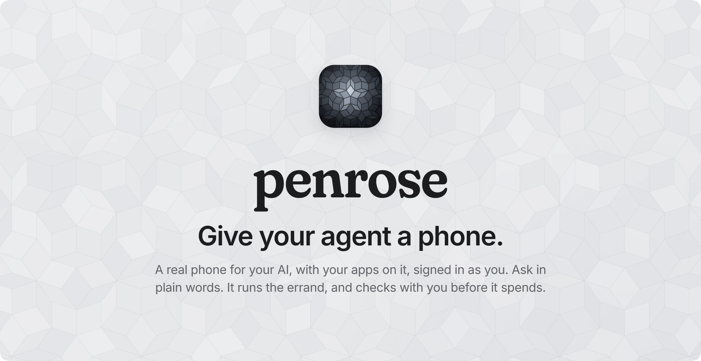
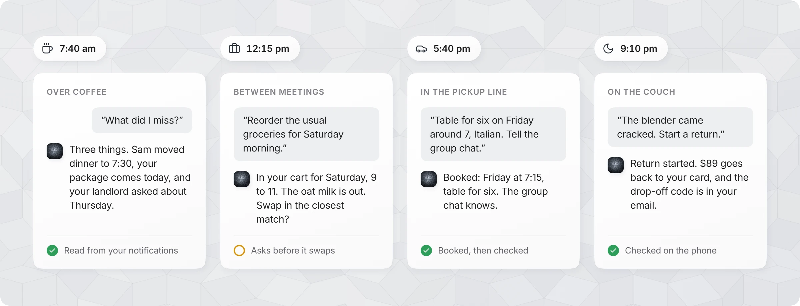
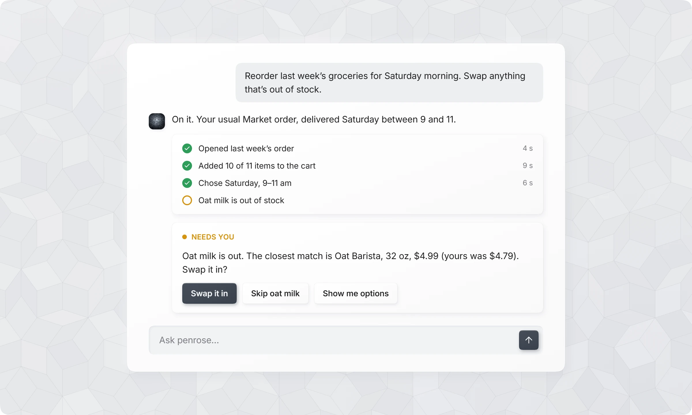
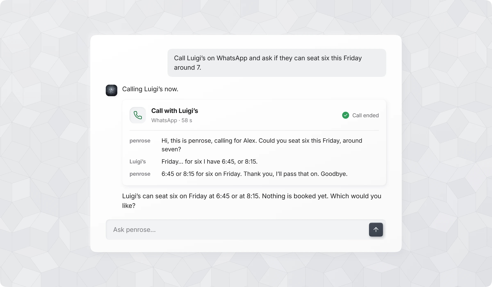
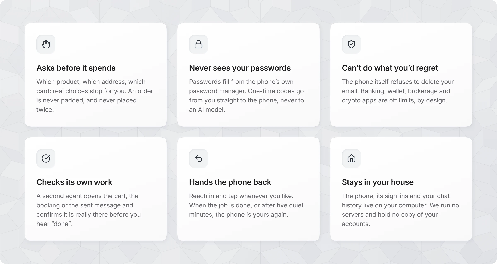
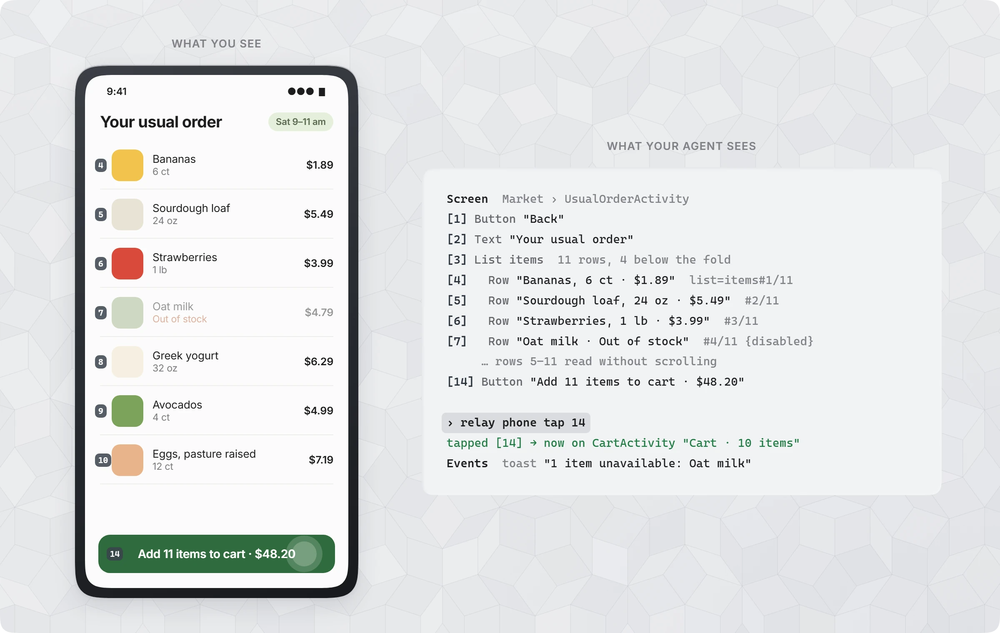
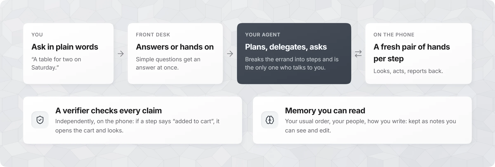
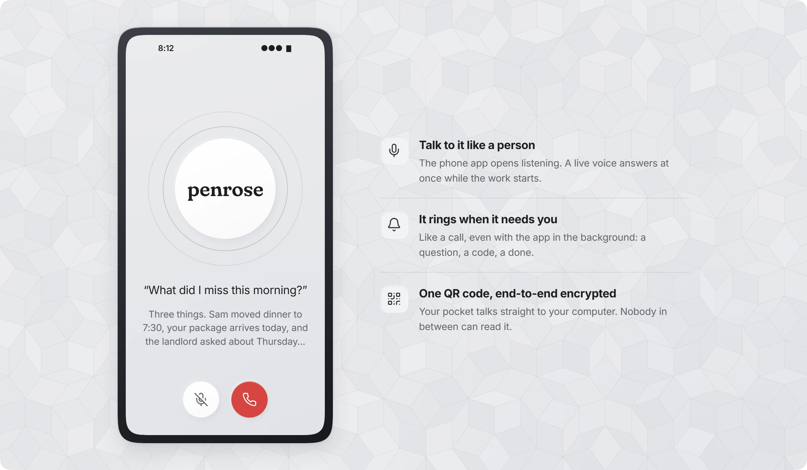

<p align="center">
  <picture>
    <source media="(prefers-color-scheme: dark)" srcset="docs/readme/hero-dark.webp">
    
  </picture>
</p>

<p align="center">
  <a href="../../releases/latest"><picture><source media="(prefers-color-scheme: dark)" srcset="docs/readme/button-download-dark.webp"></picture></a>
  <a href="#how-it-works"><picture><source media="(prefers-color-scheme: dark)" srcset="docs/readme/button-how-dark.webp"></picture></a>
  <a href="#bring-your-own-agent"><picture><source media="(prefers-color-scheme: dark)" srcset="docs/readme/button-agent-dark.webp"></picture></a>
</p>

<p align="center"><sub>Free and open source&nbsp;&nbsp;·&nbsp;&nbsp;No extra phone to buy&nbsp;&nbsp;·&nbsp;&nbsp;Windows and macOS, with Linux in preview</sub></p>

<br>

<h3 align="center">Your AI can talk. Now it can do.</h3>

<p align="center">
Ask an assistant about dinner and you get a lovely paragraph. The table, the groceries and the group chat
all live in apps on a phone, where it can’t reach.<br>So we built your AI a phone, and put it inside your computer, right
beside the AI that uses it.<br>No second device, no cables, nothing to buy: the phone runs in a window on your screen.
</p>

<p align="center">
  <picture>
    <source media="(prefers-color-scheme: dark)" srcset="docs/readme/setup-dark.webp">
    
  </picture>
</p>

<table>
<tr>
<td width="33%" valign="top">

**A phone that runs inside your computer**<br>
<sub>penrose is an app for your computer. It comes with its own Android phone, which runs in a window on your screen.
There is nothing to buy, and the phone in your pocket is never touched.</sub>

</td>
<td width="33%" valign="top">

**Your apps, signed in as you**<br>
<sub>You set it up like any new phone: sign in to Google, install your apps from Google Play, sign in to them.
You do that once.</sub>

</td>
<td width="33%" valign="top">

**An AI that uses it for you**<br>
<sub>Ask in plain English, typed or spoken. penrose opens the apps and taps, types, scrolls and calls, the way you
would, then tells you what it did.</sub>

</td>
</tr>
</table>

<br>

## A day with penrose

You don’t need another chatbot. You need the list to get shorter. penrose fits into the gaps of the day you
already have: say it once, the way you’d say it to a friend, and get on with your morning.

<p align="center">
  <picture>
    <source media="(prefers-color-scheme: dark)" srcset="docs/readme/day-dark.webp">
    
  </picture>
</p>

Type it at your desk or say it from your pocket. It’s the same penrose either way, on the same phone, in the
accounts you already have: your order history, your saved addresses, your points.

<br>

## It does the legwork. You make the calls.

<p align="center">
  <picture>
    <source media="(prefers-color-scheme: dark)" srcset="docs/readme/ask-dark.webp">
    
  </picture>
</p>

penrose does the scrolling, the searching and the forms. The decisions stay yours. When there’s a real choice
(which product, which address, which card) it stops, asks and waits. It never pads an order and never places
one twice. And before it tells you something is done, it goes back and looks.

<br>

## Anything you’d do on your phone

<table>
<tr>
<td width="50%" valign="top">

**Errands**<br>
<sub>“Reorder my usual Instacart order for Saturday morning. Swap anything that’s out.”<br>
“Where’s my Amazon order? The blender arrived broken. Start a return.”<br>
“Find every subscription I haven’t used in three months and cancel them.”</sub>

</td>
<td width="50%" valign="top">

**Plans**<br>
<sub>“Table for six on Friday around 7, Italian, near downtown. Then tell the group chat.”<br>
“Two seats together for Saturday’s show, under $150 each.”<br>
“A weekend away on my own Delta and Marriott accounts. Show me before you pay.”</sub>

</td>
</tr>
<tr>
<td width="50%" valign="top">

**People**<br>
<sub>“Tell Sam on WhatsApp that 7:30 works, the way I’d say it.”<br>
“Thank everyone who left a kind comment on my last Instagram post.”<br>
“Answer the people asking about the couch on Marketplace.”</sub>

</td>
<td width="50%" valign="top">

**Shopping**<br>
<sub>“The best-rated air purifier under $200 across three stores. Buy the cheapest.”<br>
“DoorDash dinner for four, one vegetarian, under $60, here by 7.”<br>
“List the couch on Facebook Marketplace for $300 with these photos.”</sub>

</td>
</tr>
<tr>
<td width="50%" valign="top">

**Calls**<br>
<sub>“Call the restaurant and ask if they can seat six on Friday around 7.”<br>
“Call the contractor and ask when he can come by this week.”<br>
“Call Mom on WhatsApp and ask what time their flight lands.”</sub>

</td>
<td width="50%" valign="top">

**Catching up**<br>
<sub>“What did I miss this morning?”<br>
“Is there anything in my email I need to answer today?”<br>
“What has the school group chat been saying?”</sub>

</td>
</tr>
</table>

No list of supported services to check, and no waiting for someone to build a plug-in. You install your apps from
Google Play, the way you always have, and penrose uses them.

<br>

## Some things still take a call. penrose makes it.

<p align="center">
  <picture>
    <source media="(prefers-color-scheme: dark)" srcset="docs/readme/call-dark.webp">
    
  </picture>
</p>

Ask penrose to call someone and it places the call for you, then does the talking, in a natural voice. Not
only friends and family: it can ask a restaurant whether they can seat six on Friday, ask a contractor when they
could come by, or ask a support line where your refund is.

It calls from the apps on its phone. WhatsApp, Telegram, Slack, Teams and Instagram are the ones most people use,
and every other app that can place a call works the same way. The call comes from your own account, so the person
sees it’s from you.

On the line it introduces itself as penrose, calling for you. It never pretends to be you or to be a person,
shares only what the call needs, and agrees to nothing on your behalf: if they offer two times, it brings both
back to you. When it hangs up, you get the answer and the conversation, word for word.

<br>

## Built to be trusted with your phone

<p align="center">
  <picture>
    <source media="(prefers-color-scheme: dark)" srcset="docs/readme/features-dark.webp">
    
  </picture>
</p>

Handing over your phone is a big ask, so the rules live in the phone, not in a polite request to an AI.
Passwords are filled by the phone’s own password manager and reach the agent as `[redacted]`. One-time codes go
from you straight to the phone and never touch a model, the chat or the logs. The phone refuses to delete your
email whatever the agent asks, and banking, wallet, brokerage and crypto apps stay shut.

<br>

## Phones were made for thumbs.<br>This one was made for agents.

Most AI agents squint at screenshots and guess where to tap. That’s why they’re slow, and why they miss.
penrose rebuilds the phone from the inside, so each screen arrives as text: every button, what it accepts, the
rows below the fold. Every action comes back with what changed. It waits for a page to be ready instead of
tapping a half-loaded one, and where you’d tap five times, it jumps straight there.

<p align="center">
  <picture>
    <source media="(prefers-color-scheme: dark)" srcset="docs/readme/sees-dark.webp">
    
  </picture>
</p>

<br>

## How it works

<p align="center">
  <picture>
    <source media="(prefers-color-scheme: dark)" srcset="docs/readme/how-dark.webp">
    
  </picture>
</p>

You talk to one agent. It plans the errand, gives each step to a fresh pair of hands on the phone, and has every
result checked by a verifier that trusts nothing it hasn’t seen. Afterwards penrose keeps what’s worth
remembering: your usual order, your people, how you write. Memories are plain notes you can read and edit.

<br>

## Ask from anywhere

<p align="center">
  <picture>
    <source media="(prefers-color-scheme: dark)" srcset="docs/readme/pocket-dark.webp">
    
  </picture>
</p>

penrose lives on your computer at home. Leave it on, and the penrose app in your pocket reaches it from wherever
you are: speak, and a live voice answers at once while the work starts. It rings like a call when an errand has a
question, needs a code or is done. Everything between your pocket and your computer is end-to-end encrypted, over
a link you set up yourself, free, with one click and one QR code.

<br>

## Bring your own agent

> [!TIP]
> **On a Claude Max or Team plan? You may already have paid for this.** Those plans come with API credits every
> month ($100 on Max 5x and $200 on Max 20x, as of November 2026), and they expire each month if you don’t use them.
> penrose’s own agents can run on them: link a Claude Console account in your Claude billing settings, create a key
> there and paste it into penrose. (The credits can’t be spent inside Claude Code or the Claude apps themselves, only
> on a key like this one.) [How the credits work](https://platform.claude.com/docs/about-claude/api-credits-for-subscribers).

Already living in Claude Code? Give it the phone. penrose installs a skill that teaches Claude when and how to use
it, and the same tools are available to the Claude desktop app and Cowork as a local connector. Anything with a
shell can use the `relay` command:

```console
$ relay phone open "Market"
$ relay phone screen
[3] List items  11 rows, 4 below the fold
[7]   Row "Oat milk · Out of stock"  #4/11 {disabled}
[14] Button "Add 11 items to cart · $48.20"
$ relay phone tap 14
tapped [14] → now on CartActivity "Cart · 10 items"
```

Set it up in **Settings › Connect Claude**, or run `relay setup claude-code`. One agent holds the phone at a time,
so penrose’s agents, Claude and you never fight over it.

<br>

## Get penrose

<table>
<tr>
<td width="50%" valign="top">

**1. Download and install**<br>
<sub>Get the installer from <a href="../../releases/latest">Releases</a> (the <code>.exe</code> for Windows, the
<code>.dmg</code> for a Mac) and run it, like any other app. penrose tells you when there is an update.</sub>

</td>
<td width="50%" valign="top">

**2. Let it build its phone**<br>
<sub>The first time you open penrose it downloads and sets up its phone by itself. That is about 3 GB and takes a
few minutes, once.</sub>

</td>
</tr>
<tr>
<td width="50%" valign="top">

**3. Make the phone yours**<br>
<sub>The phone appears in the penrose window. Sign in to Google on it, install the apps you use from Google Play
and sign in to them, exactly as you would on a new phone.</sub>

</td>
<td width="50%" valign="top">

**4. Add an AI key, then ask**<br>
<sub>penrose thinks with an AI model from Anthropic (Claude), OpenAI (GPT) or DeepSeek. Setup links you to the
page where you create a key, which is a kind of password for that service. Paste it in and ask for something.</sub>

</td>
</tr>
</table>

<sub><b>What you need:</b> a Windows PC or a Mac (the Linux build is a preview), a Google account, and an AI key.
penrose is free; the AI provider bills you for what you use. Your key is stored encrypted on your computer and is
only ever sent to the provider it belongs to. Talking to penrose, and the calls it makes, use an OpenAI key.</sub>

<br>

<details>
<summary><b>Questions</b></summary>

<br>

**Do I need to buy a phone?**
No. The phone is part of penrose: a real Android phone that runs in a window on your computer, with Google Play,
so you install your apps the way you always do. It’s where your computer is, so your apps see your own
neighbourhood.

**Does it use the phone I already have?**
No. Your own phone stays exactly as it is, and penrose never touches it. penrose has a second phone, on your
computer, and you sign in to your accounts there, the way you would on a new phone or a tablet.

**What’s an “agent”?**
An AI that does things instead of only answering. You say what you want; it opens the apps and gets it done.

**What’s an AI key, and how do I get one?**
It’s a kind of password that lets penrose use an AI model on your own account with Anthropic, OpenAI or
DeepSeek. You create it on their website (penrose’s setup links you to the right page), paste it in once, and pay
them for what you use. Signing in with a ChatGPT or Claude subscription doesn’t work in its place, though a Claude
Max or Team plan does include monthly credits for a key.

**What does it cost?**
penrose is free and open source. You bring a key from an AI provider, and they bill you for what you use. If you
have a Claude Max or Team plan, it includes API credits each month that penrose can run on, so it may cost you
nothing more.

**Who can see my accounts?**
You. The phone, its sign-ins and your chat history stay on your computer. We run no servers and have no accounts
for you to create. What you ask, and what’s on the phone’s screen while it works, go to the AI provider you
chose, and to nobody else.

**Can it buy things without asking?**
It asks about real choices before it acts on them, and never expands or repeats a purchase, a booking or a
message. Banking, wallet, brokerage and crypto apps are off limits in the phone itself.

**Can it call any phone number?**
It calls through apps, because its phone has no SIM card. Anyone you can call in WhatsApp, Telegram, Slack, Teams,
Instagram or another app, it can call. For ordinary phone numbers, install a calling app that dials them.

**Does the person it calls know it isn’t me?**
Yes. It says it’s penrose, calling for you. It never pretends to be you or a person, and says it’s an AI assistant
if they ask. It calls only who you asked it to, for the reason you gave, and it can’t agree to anything for you.

**Does every app work?**
Nearly all. Money apps are off limits by design, and a few apps won’t run on a phone that lives on a computer.

**Does my computer have to be on?**
Yes. penrose and its phone live on your computer, so they work while it’s on. That’s also why your sign-ins never
leave your house.

**What if I have an iPhone?**
Keep it. penrose has its own phone, an Android one, and you sign in to your apps there. That covers WhatsApp,
Instagram, Messenger and Telegram, but not iMessage, which is Apple’s alone. The penrose app for your pocket is
a web app you add from your phone’s browser.

**Windows or my Mac warned me about the installer.**
Our installers aren’t signed with a paid certificate yet, so your computer says it doesn’t recognise who made
them. On Windows, choose **More info**, then **Run anyway**. On a Mac, try to open penrose once, then go to
**System Settings › Privacy & Security**, scroll down and choose **Open Anyway**.

**How do updates work?**
penrose checks by itself. On Windows it downloads the update and asks you to restart. On a Mac it tells you a
new version is out and opens the download page: drag the new one into Applications over the old one. Your phone
and your chats are kept either way.

**Can my company use penrose, or build a product on it?**
penrose is a complete application for individual, personal use. If your company wants it customised for enterprise
use across teams, or wants to build on it without sharing its own source, write to
[penrose.ai.labs@gmail.com](mailto:penrose.ai.labs@gmail.com).

**Which AI does it use?**
Yours. Add a Claude, GPT or DeepSeek key and pick a model for each job in Settings, or drive the phone from
Claude Code instead.

</details>

<br>

## For companies

penrose is a complete application for individual, personal use. If your company wants it customised for enterprise
use across teams, write to us at [penrose.ai.labs@gmail.com](mailto:penrose.ai.labs@gmail.com).

<br>

## For developers

penrose is an Electron app with a Python backend, a React interface and an Android phone that ships with its own
Xposed module, home app and Magisk module. [docs/DEVELOPING.md](docs/DEVELOPING.md) explains how the pieces fit
and how to build them; [docs/DESKTOP.md](docs/DESKTOP.md) covers the app, the phone’s set-up and releases.
Issues and pull requests are welcome: start with [CONTRIBUTING.md](CONTRIBUTING.md). To report a security problem
privately, see [SECURITY.md](SECURITY.md).

penrose is open source under the GNU AGPL 3.0: use it and change it freely, and if you share a version of it or
build it into a product, share your source under the same license. For a closed-source product, a commercial
license is available from [penrose.ai.labs@gmail.com](mailto:penrose.ai.labs@gmail.com). [LICENSING.md](LICENSING.md) has the details.

<br>

<p align="center">
  <br>
  <sub><b>penrose</b>&nbsp;&nbsp;·&nbsp;&nbsp;Give your agent a phone.</sub><br>
  <sub>Open source under the <a href="LICENSE">GNU AGPL 3.0</a>. <a href="LICENSING.md">Commercial licenses</a> are available.</sub><br>
  <sub>App and company names belong to their owners. penrose is not affiliated with or endorsed by them.</sub>
</p>
