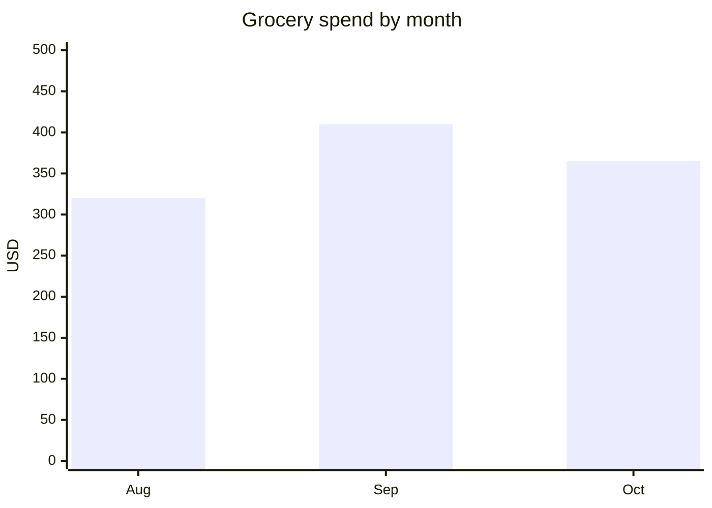
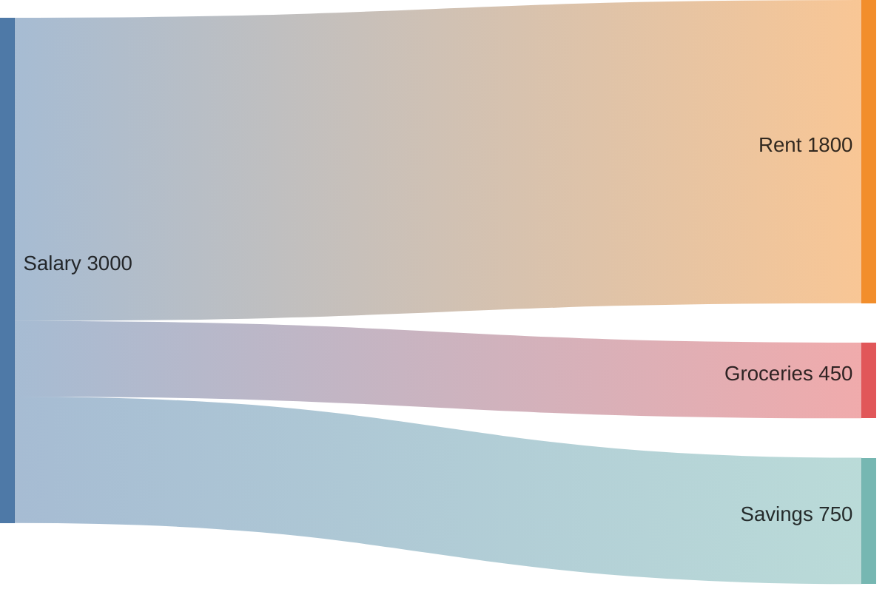

Write your words as CommonMark, with GitHub-flavoured tables, task lists and strikethrough. The window renders them
strictly by that specification and forgives nothing: start every block (a paragraph, list, heading, table, quote
or code fence) after a blank line, so that none is read as a continuation of the paragraph above it.
It also draws math written between `$$` (KaTeX; a single `$` stays a dollar sign) and a code fence tagged
`mermaid` as a diagram. Use either only where it says more than words, such as a formula, a flow or a timeline.
Mermaid also draws charts, for numbers the user would rather see than read: `pie` for shares of a whole,
`xychart-beta` for bars or lines over a few categories or dates, and `sankey-beta` for where an amount went. Keep a
chart to the numbers you actually have, and say the point it makes in words too.

A sankey is rows of `source,target,value` after its first line; quote a name that has a comma.

